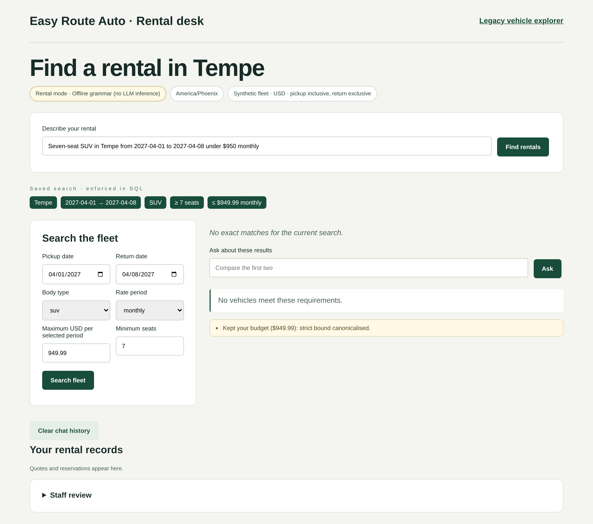
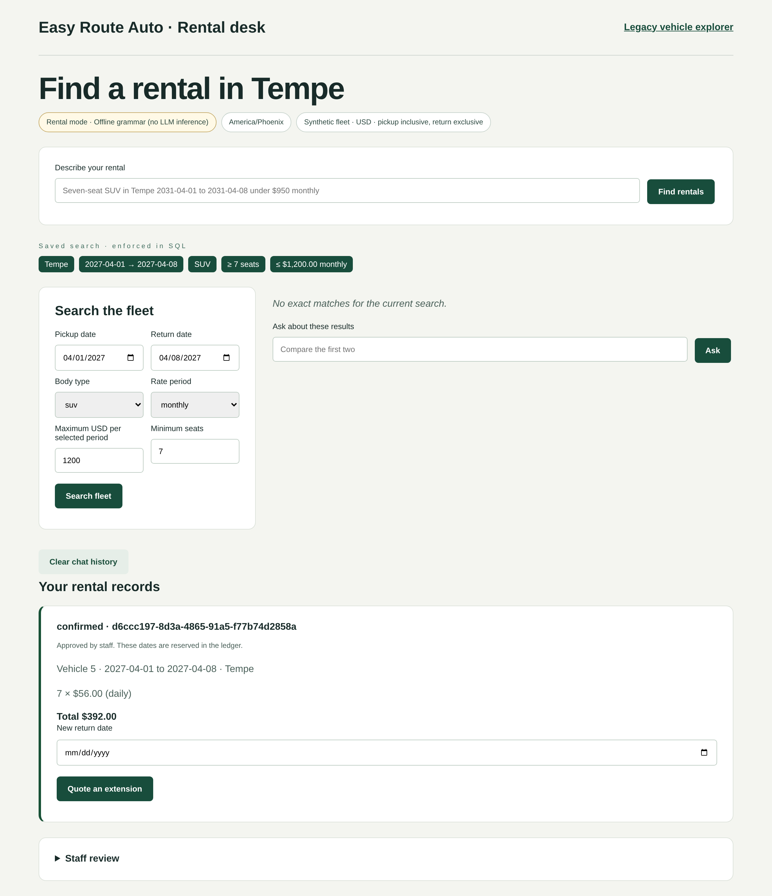
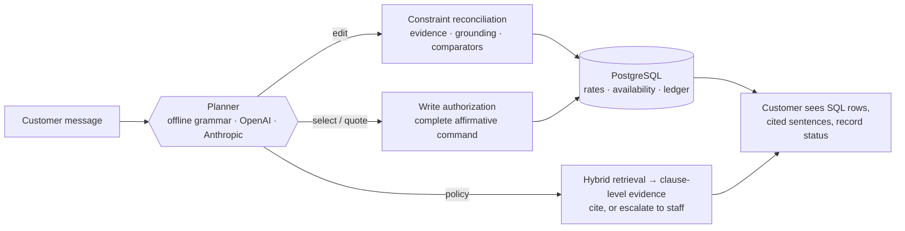

# Easy Route Auto AI

**An AI car-rental assistant that can't book the wrong car.** Customers search the fleet,
compare cars, ask policy questions and reserve, all in plain English. A language model reads
each message and proposes a typed plan. The server checks that plan against what the customer
actually said, answers every fact from the database or a cited policy document, and changes
nothing without an explicit customer command and a staff approval.

<p align="center"> </p>

**Contents:** [My internship](#my-internship-at-easy-route-auto) ·
[Results](#results-v060-measured-in-this-release) · [Demo](#three-minute-demo) ·
[How it works](#how-it-works) · [Evaluation](#evaluation) · [Run it](#run-it)

## My internship at Easy Route Auto

**AI Intern, Generative AI & LLM Applications** · Easy Route Auto LLC, Tempe, Arizona ·
May–August 2025

[Easy Route Auto](https://easyrouteauto.com/) is a Phoenix-area car rental company focused
on long-term rentals, where customers request a car and staff review and arrange pickup.
During my internship I worked on bringing AI into that customer journey:

- **AI customer assistant:** answered vehicle questions, recommended available cars,
  qualified leads and booked appointments.
- **RAG backend:** connected the conversational assistant to vehicle inventory, customer
  records and scheduling with FastAPI, so answers were grounded in current business data.
- **Staff dashboards:** gave employees visibility into customer conversations, lead activity
  and booking status.

This repository is my portfolio implementation of that assistant. It covers the same customer
journey: discovery, comparison, policy questions, quotes and staff-approved reservations. It
adds a rigorous evaluation suite, server-enforced safety guarantees and full automated
testing. It runs on synthetic fleet, pricing and policy data and contains no Easy Route Auto
source code or customer data (see [NOTICE.md](NOTICE.md)).

## Results (v0.6.0, measured in this release)

| What | Result | Evidence |
|---|---|---|
| Backend tests, SQLite with real neural models | **145 passed, 0 skipped** | `docs/v06/evidence/backend-neural.log` |
| Backend tests, PostgreSQL | **140 passed, 5 skipped (neural checks run in the SQLite job)** | `backend-postgres.log` |
| Migrations: v0.1 → head upgrade, data preserved, `alembic check` clean | SQLite ✔ · PostgreSQL ✔ | `migrations-*.log` |
| Frozen scenario suites (HTTP response **and** SQL state scored per step) | 29/29 rental regression scenarios (85/85 steps) · 17/17 legacy tasks · release set 5/11 offline (see below) | `docs/v06/evaluations/` |
| Safety on all scored steps: unintended ledger writes · silent constraint relaxations · returned vehicles violating constraints | **0 · 0 · 0** | `safety` block in each eval JSON |
| Chromium: rental (desktop + mobile), legacy, flagship demo; run back to back ×2 | all pass | `browser-*.log` |
| Docker Compose: fresh build → approve reservation → restart → same record and dates | ✔ | `compose-persistence.log` |
| Policy retrieval, 32 questions × 4 strategies | see [tradeoff](#retrieval-dense-vs-reranker) | `retrieval.json` |
| Live LLM planner on the frozen release set (`gpt-5.4-mini-2026-03-17`) | **8/11 scenarios vs. 5/11 offline · 0 unsafe outcomes** | [`eval-release-v06-live.json`](docs/v06/evaluations/eval-release-v06-live.json) |

## Three-minute demo

Start the stack ([setup](#run-it)), open **http://localhost:3000/rentals**, and use a fresh
browser session.

1. **A hard constraint the fleet can't meet.** Enter
   `Seven-seat SUV in Tempe from 2031-04-01 to 2031-04-08 under $950 monthly`.
   The result is *No exact matches*. The saved-search chips show exactly what SQL enforces:
   `≥ 7 seats`, `≤ $949.99 monthly` ("under" is strict, so $950.00 itself is excluded). Nothing
   is relaxed silently.
2. **An explicit relaxation.** Ask `Raise my budget to $1,200 monthly`. The one eligible
   seven-seater appears (Kia Sorento, $1,040/month). The seat requirement and dates are kept.
3. **An ambiguous write is refused.** Ask `Quote that vehicle`. The assistant asks you to select
   one first, and the ledger still has zero quotes. `Don't quote the first one` also writes
   nothing.
4. **A partially unsupported question.** Ask
   `Where do we meet for pickup, and can I come after midnight?` The answer cites the synthetic
   pickup sentence with its chunk ID and says the hours need staff confirmation.
5. **The valid path.** `Select the first car`, then `Quote the selected vehicle`. Review the
   itemized $392.00 quote (7 × $56 daily; a partial month bills daily) and accept the exact
   terms. The record is now **pending** and holds no dates.
6. **Staff approval.** Create a reviewer identity
   (`python -m app.employee demo-reviewer reviewer` prints a token), open *Staff review*, and
   approve. Reload: the same record ID is **confirmed** and its nights are reserved by a database
   constraint.

`scripts/flagship_browser.py` runs exactly this path in Chromium and produced the screenshots
above.

## How it works



Four boundaries do the work. [docs/ARCHITECTURE.md](docs/ARCHITECTURE.md) has the details.

1. **Constraint reconciliation** ([`rental_constraints.py`](backend/app/rental_constraints.py)).
   This is the single path for first messages and edits. Explicit customer evidence overrides
   omitted or contradicting planner fields. A planner value must be grounded in the message, or
   the customer is asked to clarify. Strict bounds become exact integer-cent ceilings. Every
   override is returned to the client and shown as a *server decision*.
2. **Write authorization** ([`rental_language.py`](backend/app/rental_language.py)). Selecting
   and quoting require a complete affirmative command that names one displayed vehicle. Negated,
   deferred or mixed requests write nothing, whatever the model proposes. Ordinals bind to a
   display turn, so a stale turn gets HTTP 409.
3. **Policy evidence** ([`rag.py`](backend/app/rag.py),
   [`rental_evidence.py`](backend/app/rental_evidence.py)). Retrieval uses MiniLM embeddings with
   FAISS and BM25, fused with RRF, plus an optional cross-encoder. Answering is stricter: each
   clause needs a supporting sentence in the right document, and undocumented details (a time, a
   fee, a permission) go to staff.
4. **Transactions** ([`rentals.py`](backend/app/rentals.py)). The ledger moves
   quoted → pending (customer accepts exact terms, idempotent) → confirmed (individual staff
   role). Occupancy is one row per vehicle-night under a composite primary key, so concurrent
   approvals cannot double-book. A failed extension rolls back with the original intact.

## Evaluation

All evaluators run the real FastAPI app against a disposable seeded database. Each step scores
the visible HTTP response **and** the SQL state afterwards (saved search, selected vehicle,
ledger rows, occupied nights). Datasets are frozen, and their SHA-256 is recorded in every
result file. Release sets are committed before they are run.

| Suite | Purpose | Deterministic result |
|---|---|---|
| `rentals_holdout` (14 scenarios) | rental workflow, references, time zones, conflicts | 14/14 scenarios · 48/48 steps |
| `rental_comparison_v5` (10) | declined/deferred writes, comparators | 10/10 scenarios · 22/22 steps |
| `holdout_v051` (5) | retained budgets, seat ceilings, record scope | 5/5 scenarios · 15/15 steps |
| `release_v06` (11, frozen before any run) | natural phrasing; live-vs-offline comparison | live 8/11 · offline 5/11 scenarios · 15/28 steps — **0 unsafe outcomes** |
| `tasks_v1` (17) | legacy dealership assistant | 17/17 |
| provider fault (mocked 503) | the failure path makes one attempt and zero writes | 1 attempt · 1 provider error · 0 writes |

`release_v06` is intentionally hard for the offline grammar. Its failures are all safe
clarifications on wording the bounded grammar can't parse ("can't go over $950 a month", "room
for seven people", "a full calendar month"). That gap is what a live model is for, and the
server boundaries above are what make it safe to try one.

### Retrieval: dense vs. reranker

Measured on 32 questions (27 answerable, 5 unanswerable) over the synthetic policy corpus,
CPU only:

| Strategy | Recall@3 | MRR | nDCG@3 | Answer support | Abstention (unanswerable) | Fact-level rental (8) | p50 / p95 latency |
|---|---|---|---|---|---|---|---|
| BM25 | 0.926 | 0.840 | 0.859 | 0.750 | 1.00 | 7/8 | 7.9 / 9.0 ms |
| Dense (MiniLM + FAISS) | 0.963 | 0.877 | 0.899 | 0.781 | 1.00 | 8/8 | 7.6 / 8.0 ms |
| Hybrid (RRF) | 0.963 | 0.858 | 0.885 | 0.750 | 1.00 | 8/8 | 7.7 / 8.4 ms |
| Hybrid + cross-encoder | 1.000 | 0.938 | 0.954 | 0.781 | 1.00 | 8/8 | 154.7 / 186.2 ms |

**Decision: dense or hybrid retrieval by default, with reranking off.** The cross-encoder fixes
ranking (MRR 0.877 → 0.938, Recall@3 → 1.00) but costs about 20× median latency (7.6 → 154.7 ms) and **doesn't
improve answer support**. Support is limited by whether a retrieved chunk *states the requested
fact*, not by its rank. On the 8 fact-level rental questions, dense and reranked both score 8/8.
`RAG_RERANK=true` enables reranking for corpora where ranking is the bottleneck.

### Live model evaluation

The live planner goes through the same validation, write authorization and reconciliation as
the offline grammar. It was run **once** over the frozen `release_v06` set (no tuning after
freezing):

| | Offline grammar | Live LLM (`gpt-5.4-mini-2026-03-17`) |
|---|---|---|
| Scenarios passed | 5 / 11 | **8 / 11** |
| Steps passed | 15 / 28 | **23 / 28** |
| Unintended writes · silent relaxations · constraint-violating vehicles | 0 · 0 · 0 | **0 · 0 · 0** |
| Provider calls attempted / completed / validated | 0 | 16 / 16 / 16 |
| Tokens in / out (whole run) | 0 | 13,342 / 1,199 |
| Assistant-turn latency p50 / p95 | 9 / 21 ms | 1,360 / 1,883 ms |

The live model handled the phrasing the grammar can't parse ("room for seven people", "a full
calendar month", "not an SUV after all"), including the full discovery → quote → staff-approval
path. Its 3 failures were all safe. One (r01) was **the server's** older comparator pre-check,
which rejects "can't go over $950" as a price floor whatever the model plans (a separate smoke
call with the same message returned the correct plan). That is the first fix for the next
release, and [VERIFICATION.md](docs/v06/VERIFICATION.md) has the per-case analysis.

Reproduce with your own key (OpenAI shown; `--provider anthropic` is also supported):

```bash
cd backend && OPENAI_API_KEY=... OPENAI_MODEL=gpt-5.4-mini-2026-03-17 python rental_eval.py --live --provider openai --gate safety --dataset evaluation/release_v06.json --out ../docs/v06/evaluations/eval-release-v06-live.json
```

## Run it

### Docker Compose

```bash
cp .env.example .env   # then set POSTGRES_PASSWORD and STAFF_TOKEN to random values
```

```bash
docker compose up --build
```

```bash
docker compose exec api python -m app.employee demo-reviewer reviewer
```

The first build downloads CPU PyTorch and the embedding models. The last command prints a staff
token for the demo.

### Local development

Requirements: Python 3.12+, Node 22, and PostgreSQL (or SQLite for a single-machine demo).

```bash
cd backend && python -m venv .venv && . .venv/bin/activate
```

```bash
pip install torch==2.15.0+cpu --index-url https://download.pytorch.org/whl/cpu && pip install -r requirements.txt -r requirements-dev.txt
```

```bash
export DATABASE_URL=sqlite:///./rental-demo.db && python -m alembic upgrade head && python -m app.seed && python -m app.ingest
```

```bash
python -m uvicorn app.main:app --host 127.0.0.1 --port 8000
```

In a second terminal:

```bash
cd frontend && npm ci && npm run build && npm start -- --hostname 127.0.0.1
```

Optional live planner: set `AI_MODE=openai` or `AI_MODE=anthropic`, plus that provider's
`*_API_KEY` and `*_MODEL`.

### Reproduce every number in this README

```bash
python scripts/verify_release.py
```

This runs lint, both test databases (set `EASY_TEST_POSTGRES_ADMIN_URL` to a disposable admin
connection), migrations, every evaluation, the frontend build, the three Chromium suites, the
secret and dependency scans, and the Compose persistence check. It writes one log per gate to
`docs/v06/evidence/` and exits non-zero on any failure. Gates whose prerequisites are missing
are reported as **blocked**, never as passed. [`docs/v06/VERIFICATION.md`](docs/v06/VERIFICATION.md)
is the release report.

## Status and limitations

| | Ready? | Why |
|---|---|---|
| Public source review | **Yes** | All gates above pass and every claim links to evidence. Data is synthetic and no secrets are included. |
| Interview demo (offline grammar + real neural retrieval) | **Yes** | The flagship path is browser-tested. |
| Interview demo with a live LLM | **Yes, with your own key** | 8/11 on held-out phrasing, 0 unsafe outcomes, about 1.4 s per turn |
| Production deployment | **No** | There is no TLS or secrets manager, the rate limit is a single process, and staff tokens are issued by CLI. The legacy dealership endpoints still use a shared demo token. |

Other known limits: the fleet has four rental vehicles in one location; the offline grammar
is bounded by design; policy answers are extracted sentences, not generated prose; the
Pinecone adapter fails closed but was never run against a live index.

## Repository

```
backend/   FastAPI app, Alembic migrations, evaluators, frozen datasets, tests
frontend/  Next.js rental desk + legacy dealership explorer, Chromium suites
scripts/   release runner, browser harness, migration and Compose checks
docs/      ARCHITECTURE · UPGRADE · v06 evidence · history of earlier releases
```

[CHANGELOG.md](CHANGELOG.md) maps each reviewer finding to its fix and regression test. MIT
licensed.
