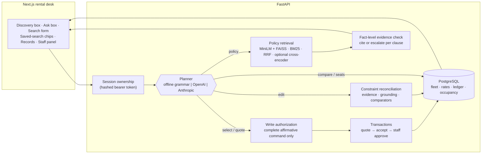

# Architecture

Easy Route Auto AI is a rental assistant whose language layer can be a bounded offline grammar
or a live LLM. In either case the **server, not the model, is the authority** for every fact the
customer sees and every record that changes. This document explains where each boundary sits
and why.

## Request flow



The planner is a single forced tool call that returns a typed
[`Plan`](../backend/app/rental_language.py) (`edit`, `compare`, `seats`, `select`, `quote`,
`policy`, `clarify` plus typed fields). It never returns prose that reaches the customer and it
cannot write anything. Everything after the planner is deterministic server code.

## The four boundaries

### 1. Constraint reconciliation (`app/rental_constraints.py`)

Every `edit` plan, whether from the grammar or a live model, on the first message or a later
turn, goes through `reconcile()` before the saved search changes. This one path enforces three
invariants:

| Invariant | Mechanism | Example |
|---|---|---|
| Explicit evidence wins | A lenient extractor finds stated seats, money and comparators, billing period, body type (with negation), dates and "keep/retain" phrases. Explicit values override omitted or contradicting planner fields, and each override is returned in `reconciliation.overrides`. | Planner drops `min_seats` from "seven-seat SUV…": the server restores `7` and shows an honest no-match. |
| Planner values must be grounded | A proposed hard-constraint value must be attributable to the current message, or it must equal the saved value. Otherwise the customer is asked to clarify and nothing is saved. Date and money spans are excluded from seat grounding. | Planner invents `min_seats=8`: the customer gets a clarification and nothing is saved. |
| Comparators keep their meaning | A strict bound is canonicalized to an exact inclusive ceiling: `price < X` becomes `price <= X − 1¢`, which is exact because currency is integer cents. Price floors, ranges and seat ceilings are unsupported by the SQL filter, so they trigger clarification and are never silently inverted. | "under $875" excludes the $875.00 car and "at most $875" includes it. "can't go over $950" is a ceiling. |

The extractor is deliberately *lenient* (it reads anywhere in a sentence), while
`rental_language.offline()` is a *strict* grammar that must consume the whole message.
Leniency is safe here because evidence can only add or confirm constraints. It never
authorizes a write.

### 2. Write authorization (`authorized_reference`)

`select` and `quote` change state, so they need a complete affirmative command that names
one vehicle ("Quote the second car", "Select the first one", "Quote the selected vehicle").
The server re-parses the customer's own words and requires the model's plan to match exactly.
Negation ("don't quote"), deferral ("after I confirm"), mixed intent and unresolved references
produce a clarification and **zero** ledger rows, whatever the model proposed. Ordinals bind to
the display turn that produced them, so after the result list changes, a stale turn returns
HTTP 409.

### 3. Policy evidence (`app/rag.py`, `app/rental_evidence.py`)

Retrieval and answering are separate problems. The index uses learned embeddings
(`all-MiniLM-L6-v2` at a pinned revision, L2-normalized, inner product in FAISS) fused with BM25
through reciprocal-rank fusion, with an optional `ms-marco-MiniLM-L-6-v2` cross-encoder. Index
generations are immutable and are swapped atomically through a `CURRENT` pointer, and an
incompatible embedding identity is rejected rather than mixed.

Answering is stricter than retrieval. The question is split into clauses, and each clause must
match a fact whose anchor sentence appears in a retrieved chunk of the right document. Details
the corpus does not establish (an exact time, a fee, a third-party permission) are returned as
`unresolved` and escalated to staff. The customer sees the cited sentence and its chunk ID.

### 4. Transactions (`app/rentals.py`)

| State | Who moves it | Holds dates? |
|---|---|---|
| `quoted` | customer action (explicit) | no; expires in 15 minutes |
| `pending` | customer accepts the **exact** terms (payload digest + idempotency key) | no |
| `confirmed` | individual staff identity with `reviewer`/`manager` role | yes: one `rental_days` row per vehicle-night, primary key `(vehicle_id, day)` |
| `extended` / `cancelled` / `declined` | staff | released or superseded atomically |

Overlap prevention is a database constraint, not application logic. Two concurrent approvals
for the same vehicle-night cannot both commit (verified on PostgreSQL). A failed extension rolls
back and leaves the original reservation and its occupied days intact. Business dates use
`America/Phoenix`.

## Model inference

| Mode | Adapter | Contract |
|---|---|---|
| `deterministic` | `rental_language.offline` | Bounded grammar. No network and zero tokens. Clarifies on anything it cannot fully parse. |
| `openai` | Responses API, `strict` function schema | forced `rental_followup` call |
| `anthropic` | Messages API, forced `tool_use` | `temperature=0`, same schema |

Each provider attempt records `provider`, `model`, `attempted`, `completed`, `validated`,
token usage, latency and the error class, with no message text or credentials. Evaluations count
actual calls from these events, so a request rejected before inference records zero calls.
Malformed envelopes, extra or unknown tool calls, invalid arguments, 429s and 5xx responses all
fail closed with HTTP 502, and the ledger is unchanged.

## Why not let the model write?

The model's job is the part it is good at: mapping messy language ("we're a family of seven…
no more than eleven hundred dollars a month") to a typed plan. Everything that must be *true*
(prices, availability, constraint satisfaction, citations, record status) comes from SQL or
from the corpus, and every write passes a deterministic authorization check. The trade-off is
narrower expression: the assistant never writes free-form answers. In exchange, every claim on
screen traces to a row or a chunk ID, and a model error results in a clarification rather than a
wrong reservation.

## Repository map

```
backend/app/
  rentals.py            HTTP routes: search, ask, discovery, quote/accept, staff decisions, extensions
  rental_constraints.py evidence extraction + reconcile()       ← single constraint path
  rental_language.py    Plan schema, offline grammar, write-command authorization
  rental_planner.py     live LLM adapters (OpenAI, Anthropic) + call instrumentation
  rag.py                ingestion, FAISS/BM25/hybrid/rerank retrieval, Pinecone adapter (fail-closed)
  rental_evidence.py    clause-level fact support and escalation
  main.py, ai.py, ...   legacy dealership assistant (v0.1–v0.2), kept and tested
backend/evaluation/     frozen scenario sets and retrieval judgments (SHA-256 recorded per run)
backend/rental_eval.py  scores HTTP-visible outcomes and SQL state per step
backend/evaluate.py     retrieval benchmark (Recall@3, MRR, nDCG, support, abstention, latency)
scripts/                release runner, browser harness, migration and Compose checks
```
