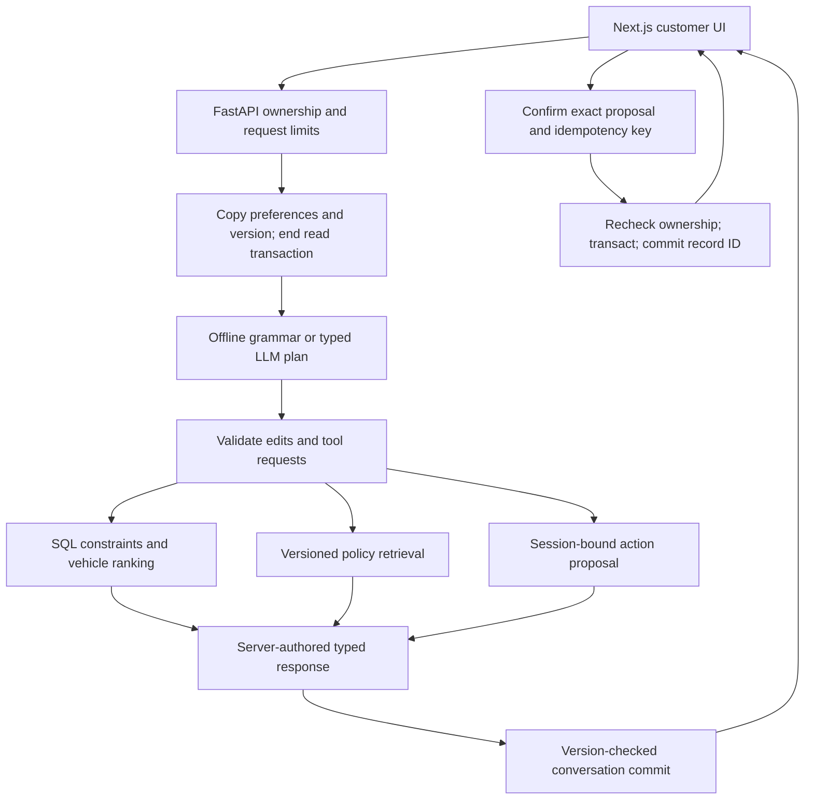

# v0.2 architecture and data flow

## Grounding boundary

Raw provider prose is never a response field rendered in the UI. The provider produces `TurnPlan`, which cannot carry arbitrary factual recommendation text, prices or committed-action statuses. Unexpected fields fail validation. A provider message without the typed plan is replaced with a fixed clarification. For every nontrivial non-greeting turn, the server itself performs inventory lookup; model tool omission cannot bypass it.

Vehicle cards contain SQL records only. Model-nominated IDs outside the SQL-filtered set are rejected as nominations, and never become cards. Explanations contain server-built statements about actual fields. Policy answers are direct chunk excerpts with stable document/chunk/version identifiers. The assistant does not claim that selecting a valid citation proves it answers the question. Action statuses originate only in a successfully committed transaction response. Chat itself always returns an empty committed-action list.

The useful trade-off is narrower expression: the model helps interpret language and choose typed tools, while the server authors displayed factual prose. This avoids pretending that another model or a keyword detector can reliably certify arbitrary model claims. Future richer generation needs claim-level evidence validation, not relaxation of this boundary.

## Preferences and concurrency

Hard fields: maximum price, body type, minimum seats, maximum mileage and minimum mpg. Soft fields: feature labels, low mileage, fuel efficiency and optional semantic preference text. Typed operations set, clear or retain one field. Duplicate/conflicting updates are rejected. Ambiguous turns ask one of fixed clarification questions and cannot change preferences.

Live edit evidence must quote the current message, but a quote is not proof of intent. Initial/tightening updates may apply after type validation. Increasing/removing a maximum, decreasing/removing a minimum or replacing/removing an existing body restriction needs an explicit session-bound preference proposal. The confirmed payload includes the expected version. The deterministic grammar is never consulted to constrain a live plan; it is a separate finite testing path.

The chat endpoint copies a snapshot and ends its database transaction before provider inference. It then uses compare-and-swap on conversation.version. Two simultaneous turns with the same snapshot cannot both commit. Privacy clearing increments the version at the database write boundary before deleting messages, so an older in-flight plan cannot revive cleared history. PostgreSQL tests cover the same safeguards in a separately allocated database.

## Retrieval lifecycle

Document JSON → validate TXT/Markdown and limits → deterministic word chunking → batched learned MiniLM encoding → L2-normalized vectors → FAISS inner-product index plus manifest → atomic generation switch.

The manifest records embedding model/revision/dimension/normalization/metric, chunker version, chunk identities and the index hash. Incompatible configuration fails rather than silently mixing vectors. Writers take an exclusive process file lock; readers take a shared lock until generation files are consumed. Updating/deleting documents rebuilds and removes stale local generations. This is a small-corpus design, not incremental indexing at production scale.

BM25 uses the same chunks as dense retrieval. Hybrid ranks use reciprocal-rank fusion with constant 60. Optional cross-encoder reranking scores up to 12 candidates. Topic filters are applied before local ranking and sent to Pinecone. Original policy questions remain unchanged; no query-rewriting feature is claimed. The same dense similarity diagnostic is computed even for lexical ranking, and the 0.35 abstention threshold is a documented heuristic.

Pinecone uses generation namespaces and the same local manifest contract. Upsert/query/delete failures propagate as explicit failures without a local-success fallback. Old remote namespaces are removed after the new active pointer is installed; a cleanup failure is reported, but reconciliation and eventual-consistency polling need live integration work. FAISS is the only vector backend actually tested with real learned vectors here.

Policy text never drives SQL truth or action execution. It is not sent back as provider instructions. User-supplied documents are untrusted excerpts, and React escapes their contents.

## Ranking

SQL hard filtering precedes scoring. The four configurable components are feature overlap, mileage, mpg and semantic cosine similarity. Defaults are 0.3/0.3/0.3/0.1; only active components contribute to the denominator. Mileage score is clamp(1 - miles/200000); mpg is clamp((mpg-10)/50). Missing soft attributes contribute zero and are explicitly labeled unknown. A missing required attribute fails the corresponding SQL filter. Ties resolve by price then vehicle ID.

Semantic matching uses the same learned encoder on preference text and the current SQL vehicle descriptions, and defaults off. It was executed in a local neural regression test. There is no trained ranker or claim of learned ranking quality. The current scorer loads all SQL-qualified records before output pagination, which is appropriate for the small synthetic fixture but needs scalable query/ranking work for large inventories.

## Operational transactions

Idempotency reservation occurs before a write. The key is unique per session; a canonical kind/arguments hash prevents key reuse with different payloads. The result is stored in the same transaction as the business write. A successful identical retry returns the original response. The original result may be a historical snapshot; use GET appointments to see current status.

Proposals carry exact normalized arguments, session ownership, a five-minute expiry and a consumed flag. Confirmation rechecks all fields, authorization and business rules, then marks the proposal consumed in the transaction that stores the committed result. A new idempotency key cannot replay a consumed proposal. Generic chat text does not invoke this confirmation endpoint.

Booking locks the current PostgreSQL vehicle row, validates the slot in America/Phoenix, and inserts into the active `(vehicle_id, slot)` partial unique index. Rescheduling updates the original booking in one transaction. A failed unique constraint rolls back the move and preserves the old appointment. Capacity is per vehicle only; no staff-wide capacity model exists.

Chat deletion/expiry removes messages, preferences, proposals and personal lead records, retaining minimal session ownership and operational bookings/idempotency. Appointment → conversation uses RESTRICT, preventing cascade deletion of bookings at the database layer. An expired chat token still authorizes its owner's operational appointment management. Operational retention duration and account/token recovery remain unfinished business-policy decisions.

## Observability and security scope

Responses carry request IDs; planner traces capture model identity, attempts/retries, nullable usage/cost and tool durations. Telemetry does not record authorization headers or raw provider messages. User messages and lead proposal data are application records, governed by deletion, not emitted as diagnostic logs. Traces are local message records, not an external monitoring system. Provider planning uses at most three bounded HTTP attempts and a total deadline; no business mutation is retried by the model.

Body limits, bounded output pagination, session-token ownership and local in-process rate limiting are implemented. The shared staff token remains a local-only demonstration limitation. Individual authentication, roles, distributed throttling, audit-event retention, production ingress and recovery are not implemented, so no production/deployment-readiness claim is made.
